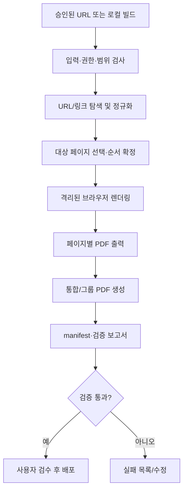

# 05. 아키텍처

## 1. 전체 흐름

## 2. 주요 모듈
- **Input/Audit**: URL/로컬 입력과 접근·복제 승인, 구조·의존성 확인.
- **Fetch Policy**: SSRF 보호, DNS/리다이렉트/리소스 요청 검증, origin·path·robots·rate 제한.
- **Discover**: 링크 수집, URL 정규화, 순환·중복 방지, 깊이와 페이지 수 제한.
- **Select**: 발견 목록에 include/exclude/수동 순서를 적용.
- **Render**: Playwright 프린트 렌더링, 대기 조건, 화면 UI 제외, 자산 실패 보고.
- **PDF**: 페이지별 출력, 병합, 목차/북마크 PoC 및 링크 정책.
- **Report**: manifest, 진단·검증 보고서, 실패 종료 코드.

## 3. 신뢰 경계
1. **입력**: URL·HTML·JS·리다이렉트 모두 비신뢰. CLI는 허용 사이트만 수집.
2. **네트워크**: 원격은 HTTPS/승인 origin·경로만 허용. 호스트 이름만 검사해서 끝내지 말고 DNS와 실제 연결 주소를 방어; 브라우저의 모든 하위 요청·리다이렉트도 검사. loopback/사설/링크로컬/예약 범위·클라우드 메타데이터 차단.
3. **로컬**: `--source` 파일 경로는 선택한 루트 밖을 참조하지 않도록 경로 정규화/심볼릭 링크 방지. 로컬 서버는 루프백 바인딩, 원격 네트워크 사용 금지.
4. **리소스**: 외부 CDN/iframe/다운로드는 기본 거부하고, 필요한 경우 명시적 예외는 보안 검토. 렌더링 콘텐츠는 임의 명령 실행에 접근하지 못하게 격리.
5. **출력**: 경로 탈출 방지, HTML로부터 만든 파일명 정제, 사용자 원본 데이터·시크릿 로그 마스킹. 생성 파일은 자동 대외 배포하지 않음.

## 4. 기술 선택(잠정)
- Node.js LTS, TypeScript: CLI/URL 정책/데이터 흐름
- Playwright + Chromium: 브라우저 기반 PDF 렌더링
- PDF 병합 라이브러리: Phase 0 PoC로 링크/북마크 지원 확인 후 선택
- 테스트: 단위 테스트 + 로컬 fixture 서버 + 소량 E2E

## 5. 확장 포인트
특정 사이트 메뉴 분석을 위해 별도 Adapter 인터페이스를 추가할 수 있지만 **MVP는 표준 링크 탐색부터 구현**. KICC 특수 규칙을 코어에 넣지 않는다.
